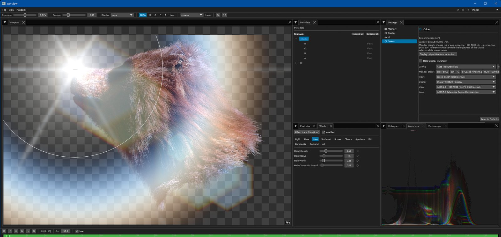
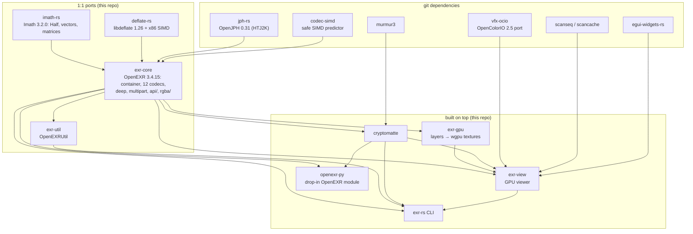
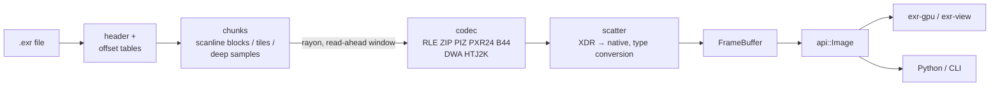
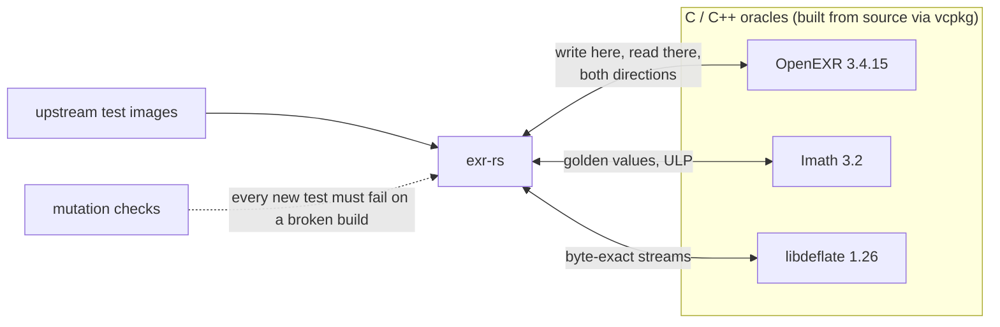
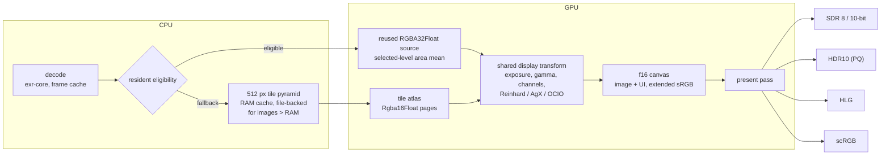

<div align="center">

# exr-rs

**OpenEXR, rewritten in Rust — byte for byte.**

A pure-Rust, FFI-free, 1:1 port of the OpenEXR C++ stack (OpenEXR, Imath, libdeflate,
OpenJPH), verified against the real C++ library, plus a GPU layer, a GPU viewer that hosts OpenFX plug-ins and a
drop-in `OpenEXR` Python module.


[](https://ssoj13.github.io/exr-rs/)

**[Documentation](https://ssoj13.github.io/exr-rs/)** · **[Releases](https://github.com/ssoj13/exr-rs/releases)**

[](docs/book/src/assets/viewer-lens-flare.jpg)

<sub>`exr-rs view` on an HDR10 (PQ) display: an RGBA EXR under the Lens Flare effect, the Effects, Metadata and Colour panels, waveform. Click for full size.</sub>

</div>

---

## Why this exists

OpenEXR is the interchange format of the VFX industry, and its C++ implementation is excellent.
Using it outside a studio build system is the hard part.

- **Builds.** The stack is several libraries with their own build systems and version coupling:
  OpenEXR, Imath, libdeflate (zlib before 3.2), OpenJPH since 3.4 — and around it, in any real
  pipeline, TBB, OpenImageIO, OpenColorIO, USD. OpenEXR's own changelog carries entries like
  *"Fix for linking statically against an external libdeflate"* and *"Fix installation of Imath
  and libdeflate in windows CI"*. vcpkg made this easier, not easy: this project's own C++
  reference builds still need a detected MSVC environment, a matching vcpkg triplet, and static vs
  DLL linkage with a consistent CRT (`/MT` vs `/MD`) across every library.
- **Modularity.** A C++ library does not drop into another project. Its headers, link order,
  exported symbols and runtime all come along, and two dependencies that bundle different builds of
  the same library conflict at link or load time.
- **Python.** The official module is a separate build of its own: pybind11, CMake, the C++
  libraries, one wheel per interpreter version. `openexr-py` is an abi3 wheel built by maturin: one
  wheel per platform covers Python 3.8 and later.

- **Ownership.** I wanted an implementation of my own: one I can take apart, reshape and extend
  as I see fit, in a language and stack I like working in, on every platform at once — built the
  way I decided, not the way someone somewhere once did. The format core stays a faithful 1:1 port;
  around it sit my own designs:
  - writers that take the pixel bytes on every call, so one reusable strip buffer streams a
    65k image;
  - multipart files with per-part cached readers and writers, so interleaved access resumes where
    it left off;
  - rayon parallelism with read-ahead windows, codec and buffer pools, and engagement probes that
    prove in tests that every fast path really ran;
  - structured `Unsupported` errors that name the reader a file needs;
  - `exr-gpu`, which puts EXR layers straight into wgpu textures with checked sizing;
  - a viewer with resident GPU display for eligible images and a tiled fallback with
    out-of-core reading of 65k files, a playhead-ranked frame cache (`scancache`), an f16
    canvas with SDR, PQ, HLG and scRGB output, and OCIO;
  - Cryptomatte **encoding** and injection, down to the Python module.

In Rust the whole stack is `cargo build`. Each crate works alone — `imath-rs` or `deflate-rs`
need nothing else — and joins another project with one line in `Cargo.toml`. No system
libraries, no CMake, no FFI.

Then there is safety. EXR files are untrusted input to a lot of software, and a format parser is
exactly where C++ memory errors become crashes and vulnerabilities. Here the compiler rules out
use-after-free, data races and unchecked out-of-bounds access, and `exr-core` has no `unsafe` code
at all. The same strictness makes Rust a good language for AI-assisted development: the type
system, exhaustive matching and the borrow checker catch a whole class of mistakes at compile
time, so generated code has to be correct in the places C++ would let it slip.

exr-rs is also the foundation for a series of professional EXR tools built on it, with no native
dependencies to manage. Other pure-Rust EXR work (such as `exrs`) is an independent design;
exr-rs aims at **strict C++ parity across the whole stack**.

## Highlights

- **Whole-format coverage.** Scanline, tiled (one level, mipmap, ripmap), deep (scanline and
  tiled), multipart, multiview, luminance-chroma, and all **12 compression codecs**.
- **Byte-identical to C++.** ZIP/ZIPS, PIZ, PXR24, B44/B44A, DWAA/DWAB and HTJ2K write the
  *same bytes* as C++ OpenEXR 3.4.15; every codec decodes pixel-exact in both directions.
  Checked by an oracle built from the real C++ library.
- **No native dependencies.** No `bindgen`, no `extern "C"`, no system OpenEXR or zlib: one
  `cargo build`. `exr-core` contains **no `unsafe` at all**; SIMD lives in `deflate-rs` and
  `codec-simd`, each behind a safe scalar source of truth.
- **Parallel and hardened.** Rayon chunk parallelism on every read/write path, byte-identical at
  any thread count; readers validate declared sizes with checked arithmetic and use fallible
  allocation.
- **Beyond OpenEXR.** Wgpu upload of EXR layers, a GPU viewer for images from thumbnails to
  65k with OCIO and HDR output, Cryptomatte decode *and* encode, and a Python module that
  replaces the official one without code changes.

## Contents

[Why](#why-this-exists) · [Architecture](#architecture) · [Status vs OpenEXR](#status-report-exr-rs-vs-openexr) ·
[Performance](#performance) · [Verification](#verification) · [Viewer](#exr-view-the-viewer) ·
[Quick start](#quick-start) · [Building and testing](#building-and-testing) ·
[Roadmap](#roadmap) · [Reference sources](#reference-sources) · [License](#license)

---

## Architecture



| Crate | What it is |
|---|---|
| [`imath-rs`](crates/imath-rs) | Imath 3.2.0: `Half`, vectors, matrices, boxes, colour, noise. Bit-exact against C++ Imath. |
| [`deflate-rs`](crates/deflate-rs) | libdeflate 1.26: inflate, all 12 compression levels, zlib/gzip, CRC32, x86 SIMD. Byte-identical to C. |
| [`exr-core`](crates/exr-core) | OpenEXR: container, attributes, all 12 codecs, scanline/tiled/deep/multipart, raw-chunk passthrough, the idiomatic `api` facade, and `rgba` (RGBA, ACES, luminance-chroma). |
| [`cryptomatte`](crates/cryptomatte) | Cryptomatte 1.2: ids, ranks, metadata, manifests, matte extraction, **encoding** and injection. |
| [`exr-gpu`](crates/exr-gpu) | Decoded layers into `wgpu` textures or storage buffers, with checked sizing and readback. |
| [`exr-util`](crates/exr-util) | OpenEXRUtil: in-memory flat and deep images, whole-file image I/O and `CheckFile`, behind the whole-image CLI tools. |
| [`exr-image`](crates/exr-image) | EXR decoding for the `image` crate through exr-core (`exr_image::register()`). |
| [`exr-import`](crates/exr-import) | PNG, JPEG, TIFF, DPX, HDR, ... as scene-linear EXR-ready images (viewer, `convert`). |
| [`exr-view`](crates/exr-view) | The GPU viewer library (winit, egui, wgpu) behind `exr-rs view`. |
| [`openexr-py`](crates/openexr-py) | The `OpenEXR` Python module on PyO3 + numpy (built by maturin, outside the cargo workspace). |
| `exr-rs` (root) | The one binary: the command-line tools and the viewer. |

### Read and write pipeline

`exr-core` keeps the C++ structure file for file; only its `api` facade is shaped for Rust.



Writing runs the same stages backwards: gather, compress in parallel, and write chunks in file
order. Writers take the pixel bytes on each call, so one strip buffer can stream a 65k image.

---

## Status report: exr-rs vs OpenEXR

*The behavioural target is C++ OpenEXR **3.4.15**.*

| Area | OpenEXR (C++) | exr-rs | State |
|---|---|---|---|
| Header, attributes, all standard attribute types | IlmImf / OpenEXRCore | 1:1 port, 3.4.15 behaviour | ✅ |
| Scanline and tiled images (mipmap, ripmap, both rounding modes) | ✅ | ✅ | ✅ |
| Deep data (scanline and tiled, `CompositeDeepScanLine`) | ✅ | ✅ | ✅ |
| Multipart and multiview | ✅ | ✅ (per-part cached readers and writers) | ✅ |
| Compression: NONE, RLE, ZIPS, ZIP, PIZ, PXR24, B44, B44A, DWAA, DWAB, HTJ2K256, HTJ2K32 | ✅ | all 12 | ✅ writes byte-identical for ZIP/ZIPS, PIZ, PXR24, B44/B44A, DWAA/DWAB, HTJ2K; every codec pixel-exact both ways |
| RGBA, ACES, luminance-chroma (YCA), LUTs | `ImfRgba*`, `ImfAces*` | `rgba/` | ✅ |
| ID manifest | ✅ | ✅ | ✅ |
| Non-UTF-8 attribute and channel names | ✅ | round-trip byte-exact (also through Python) | ✅ |
| Error classes (Iex, checked arithmetic) | ✅ | 1:1 taxonomy | ✅ one documented addition: `Unsupported` for the facade |
| Threading | IlmThread pool | rayon on all 8 read/write × storage paths | ✅ output identical at every thread count |
| Python `OpenEXR` module | pybind11 | PyO3 drop-in, plus `OpenEXR.cryptomatte` | ✅ official OpenEXR Python tests pass |
| `exrheader` | ✅ | `exr-rs info` | ✅ output byte-identical (`cargo xtask parity-header`) |
| Ten ported command-line tools (`exrcheck`, `exrmaketiled`, `exrmakepreview`, `exrenvmap`, `exrmultipart`, `exrmultiview`, `exrstdattr`, `exrmetrics`, `exrmanifest`, `exr2aces`) | ✅ | `check`, `tile`, `preview`, `envmap`, `multipart`, `multiview`, `attr`, `metrics`, `manifest`, `aces` | ✅ compared with the C++ tools (`cargo xtask parity-tools`) |
| OpenEXRUtil (`ImfImage`, `ImfFlatImage`, `ImfDeepImage`, `ImfCheckFile`) | ✅ | `exr-util` | ✅ |
| Native code | C / C++ | Rust; `unsafe` only in `deflate-rs` SIMD and `codec-simd`, none in `exr-core` | ✅ no FFI |
| GPU upload, GPU viewer, Cryptomatte encode | — | `exr-gpu`, `exr-view`, `cryptomatte` | ➕ beyond OpenEXR |

---

## Performance

Speed is being brought to C++ level codec by codec. The ratios below are
**exr-rs time ÷ C++ time**, one thread, codec only (no file I/O), 16384-wide images. **1.00 is
parity, lower is better.**

| Codec | Compress | Decompress | Notes |
|---|---:|---:|---|
| HTJ2K256 | 1.08 | 1.01 | at parity |
| DWAA | 1.25 | 1.14 | was 1.70 before the `FastHufDecoder` port |
| PIZ | 1.31 | 1.72 | was 3.83 before the `FastHufDecoder` port |
| ZIP | 1.77 | 2.63 | pre-SIMD figure; the SIMD predictor has since made decompression 1.68× faster |

> [!NOTE]
> Measured 2026-09-24 on one machine under 50–100% background load, median of 5, interleaved
> A/B runs. A quiet-machine run is next on the roadmap.

Measured speed-ups of the parallel and pipeline work:

| Path | Speed-up |
|---|---|
| Flat tiled read, 24 threads vs 1 | 3.72–3.92× |
| Deep read, 24 threads vs 1 | 1.91× |
| Uncompressed read / write, one thread (const-generic channel scatter/gather) | 1.61× / 1.24× |
| ZIP decode-side predictor (SIMD) | 5.7× on the kernel, 1.68× on `uncompress()` |

Every fast path has an engagement test (`exr_core::probe`) that proves the parallel or SIMD path
ran.

---

## Verification



| Gate | Result |
|---|---|
| `cargo xtask parity-exr`: 108 tests against real C++ OpenEXR 3.4.15, both directions | ✅ 108/108 |
| `cargo xtask parity`: Imath goldens | ✅ bit-exact / within ULP |
| `cargo xtask parity-deflate`: libdeflate | ✅ byte-identical |
| `cargo xtask parity-header`: `exr-rs info` vs `exrheader` | ✅ byte-identical |
| Corpus runner over OpenEXR's own test images | ✅ no panics; lossless files round-trip bit-exact |
| Official OpenEXR Python tests (vendored) against `openexr-py` | ✅ |
| `exr-view` tests, including GPU render and present-pass tests | ✅ |

`python bootstrap.py t` runs cargo tests, clippy, the `parity`, `parity-deflate` and `parity-exr`
oracle gates and pytest; `parity-header` and `parity-tools` run on their own. The
tests on real images (the corpus, OpenEXR's and openexr-images' files, the Cryptomatte samples)
read a separate image set and are off by default: a plain `cargo test` lists them as ignored,
`--features test-data` (which the gate turns on) runs them. A missing C++ oracle fails the gate;
`EXR_ALLOW_SKIP=1` skips those tests explicitly.

---

## exr-view: the viewer



- **Resident and file-backed display.** Images up to 8192 pixels per dimension can stay
  resident on the GPU and be reduced there, within device limits, memory budgets and the
  supported source formats; exceptional f32 data falls back to CPU f64 tiles. Other images retain the bounded 512-pixel pyramid;
  files larger than RAM are read band by band, and matching file mip levels are reused.
- **Other formats.** Besides EXR the viewer and `exr-rs convert` read PNG, JPEG, TIFF, DPX, Cineon, Radiance HDR,
  BMP, TGA, SGI, ICO, GIF, WebP, PNM/PFM, IFF, RLA and Softimage PIC through `vfx-io`, as scene-linear
  associated-alpha frames (the colour rule is in the [viewer chapter](docs/book/src/user-guide/viewer.md)).
  EXR keeps its own readers.
- **Sequences.** `name.####.ext` detection (EXR and the formats above), playback with a playhead-ranked frame cache, scrubbing,
  reverse play, and reload when frames change on disk. The current frame stays visible until
  its replacement is ready to draw, so playback never flashes blank.
- **Colour.** Built-in exposure, gamma, channel isolation and tone operators (Reinhard, AgX), or
  a full **OCIO** display/view/look transform (the ACES 2.0 configs built in, or any `.ocio`). The
  GPU result matches a CPU twin within one 8-bit code.
- **HDR output.** SDR 8/10-bit, HDR10 (PQ), HLG (BT.2100, OOTF for the display's peak) and
  scRGB, as the display and GPU offer them. SDR white and the display peak come from the OS or
  Settings.
- **Inspection.** Every channel and layer, per-pixel values of all channels, the complete header,
  histogram, waveform and vectorscope, and a Cryptomatte pick and matte overlay.
- **OpenFX host.** The viewer is an OpenFX host: it finds installed `.ofx` plug-ins the way Nuke,
  Resolve or Houdini do (`OFX_PLUGIN_PATH`, then the system OFX folder, e.g.
  `C:\Program Files\Common Files\OFX\Plugins`) and applies them to the shown image, with their
  parameter panels, presets and overlays. An experimental bundle of effects written in Rust
  (Basic grade, Gaussian Blur, Lens Flare, Defocus, Fractal 2D / 3D and more) comes from
  [ofx-rs](https://github.com/ssoj13/ofx-rs): download the release archive for your platform
  (`ofx-effects-<version>-windows-x64.zip`, `-linux-x64.zip` or `-macos-arm64.zip`) and unpack
  `ofx-effects.ofx.bundle` into the OFX folder (see its `INSTALL.md`).
- **More.** Dockable layouts that are saved, a command registry shared by keys and
  menus, and saving the view as PNG (`--screenshot` from the CLI).

---

## Quick start

### Command line

```text
exr-rs info <file>                            # full header, byte-identical to exrheader
exr-rs convert <in> <out> [--compress <c>]    # re-encode with any codec
exr-rs view [--auto] <file|dir|frame>         # the GPU viewer (--auto: detect sequences)
exr-rs v                                    # start the viewer without a path (also: exr-rs view)
exr-rs view --help                           # show viewer options (--empty/-e remains optional)
exr-rs view <file> --screenshot <out.png>     # save the image as the viewer shows it
exr-rs cryptomatte info|extract|encode|inject  # Cryptomatte tools
```

Commands without arguments show help and common examples. Every tool has a visible
single-letter alias, such as `i` for `info`, `x` for `convert` and `v` for `view`;
`exr-rs --help` lists them. Cryptomatte also supports `i/e/n/j` for
`info/extract/encode/inject`.

### Rust

Every crate lives in this repository; depend on it by git:

```toml
[dependencies]
exr-core = { git = "ssh://git@github.com/ssoj13/exr-rs.git", branch = "main" }
# the same for imath-rs, deflate-rs, cryptomatte, exr-gpu, exr-view
```

```rust
// Single-part scanline or tiled image into a flat Image.
let img = exr_core::read("beauty.exr")?;
for (name, data) in img.channels() {
    // data: ChannelData::{Half, Float, Uint}
}
img.write("out.exr", exr_core::attr::Compression::Zip)?;
```

Deep and multipart files use the low-level readers (`MultiPartInputFile`,
`DeepScanLineInputFile`, ...); the `Image` facade returns a structured `Unsupported` error
that names the right one. `Image::read_all` keeps tiling, every MIP/RIP level and subsampled
channels as stored; `RgbaInputFile` reconstructs luminance-chroma files as RGBA. See the
[library guide](https://ssoj13.github.io/exr-rs/user-guide/library.html).

Into GPU memory:

```rust
let loader = exr_gpu::GpuLoader::open("comp.exr")?;   // single-part, multipart or subsampled
let part = loader.default_part();
let layer = part.default_layer().unwrap();
let image = part.load_layer(layer, &device, &queue, wgpu::TextureUsages::TEXTURE_BINDING)?;
// image.texture / image.view are ready to sample; image.read_back(..) copies back to the CPU.
```

### Python

A drop-in replacement for the official `OpenEXR` module: existing `import OpenEXR` code runs
unchanged.

```python
import OpenEXR

with OpenEXR.File("beauty.exr") as f:
    rgb = f.channels()["RGB"].pixels   # numpy array
    header = f.header()

OpenEXR.File(header, channels).write("out.exr")
```

It covers the numpy `File` / `Part` / `Channel` API, header round trips, multipart, deep data,
the legacy `InputFile` / `OutputFile` API, the companion `Imath` module, and
`OpenEXR.cryptomatte`.

---

## Building and testing

Stable Rust **1.96+**, edition 2024 (the viewer's OCIO sets the MSRV).

```sh
cargo build --release          # the exr-rs binary (CLI + viewer), no system libraries
python bootstrap.py b          # the exr-rs binary (release; -d for debug)
python bootstrap.py b p        # the OpenEXR Python wheel via maturin
python bootstrap.py t          # the full gate: tests, clippy, oracles, pytest
python bootstrap.py c          # clippy -D warnings
```

The C/C++ oracle gates (`cargo xtask parity-exr`, `parity`, `parity-deflate`) compile
small oracles against the vcpkg-installed reference libraries, with the MSVC environment detected
by `vcv-rs`. They run on Windows; elsewhere the committed goldens still run under `cargo test`.
Setup (`VCPKG_INSTALLED`, triplets) is in the guide's
[Parity and testing](https://ssoj13.github.io/exr-rs/developer-guide/parity.html) page.

The user and developer guide is an [mdBook](https://rust-lang.github.io/mdBook/), online at
<https://ssoj13.github.io/exr-rs/> (locally: `mdbook serve docs/book`). See also [`CHANGELOG.md`](CHANGELOG.md)
and [`docs/DIAGRAMS.md`](docs/DIAGRAMS.md).

---

## Roadmap

- Performance: quiet-machine CPU measurements against C++ 3.4.15, further SIMD where profiling
  shows a dominant kernel (`apply_lut`), the remaining OpenJPH allocation work.
- HDR / OCIO follow-ups in the viewer.

---

Issues and reports are welcome.

---

## Reference sources

Upstream sources are not part of the repo. Each port was made against a pinned commit; clone it
anywhere to diff against the port. OpenEXR has two pins: the file layout comes from v3.3.11,
behaviour follows **v3.4.15**, the version the oracle links. Source paths cited in the code
name the repository, then the path inside it (`openexr/src/bin/exrmaketiled/...`,
`libdeflate/lib/deflate_compress.c`).

| Upstream | Pinned commit |
|---|---|
| [AcademySoftwareFoundation/openexr](https://github.com/AcademySoftwareFoundation/openexr) | `e71cdd5d30a146dcb56c5e4c576d9e9d3c45f4fb` (v3.4.15, behaviour) |
| — port base, same repository | `c949e9f7be387daeac44797e04b7e6951e583901` (v3.3.11, file layout) |
| [AcademySoftwareFoundation/openexr-images](https://github.com/AcademySoftwareFoundation/openexr-images) | `e38ffb0790f62f05a6f083a6fa4cac150b3b7452` (v1.0+) |
| [AcademySoftwareFoundation/Imath](https://github.com/AcademySoftwareFoundation/Imath) | `9ff104bd3a40b8c3f811fdbd3f217c32d45e4a11` (v3.2.0) |
| [ebiggers/libdeflate](https://github.com/ebiggers/libdeflate) | `92e6a0db9fa848d742f9eb286c92afc60f2c3dda` (v1.26) |

The OpenJPH port lives in [`jph-rs`](https://github.com/ssoj13/jph-rs), which pins its own
reference.

Nothing here needs these trees checked out. The oracles link the vcpkg libraries pinned in
`xtask/vcpkg.json`; the two oracles that compile OpenEXR's own tools (`cargo xtask
parity-header`, `parity-tools`) fetch the v3.4.15 sources themselves into
`target/ref/openexr-v3.4.15` and check the commit. The tests read only the private image set
(`EXR_TEST_DATA`), which holds the same OpenEXR and openexr-images commits; `EXR_CORPUS_DIR`
points the corpus runner at another OpenEXR test tree.

---

## License

**BSD-3-Clause** — see [`LICENSE`](LICENSE). Each ported crate keeps the license of the
project it ports: `exr-core`, `exr-util` and `openexr-py` (OpenEXR), `imath-rs` (Imath) and
`cryptomatte` (Cryptomatte) are BSD-3-Clause, `deflate-rs` (libdeflate) is MIT; see each crate's
`LICENSE`. The upstream notices, including those of the ported projects pulled in through git
dependencies, are in [`THIRD-PARTY-NOTICES.md`](THIRD-PARTY-NOTICES.md); release ZIPs also carry
`THIRD-PARTY-LICENSES.html` with the license of every crate in the binary.
