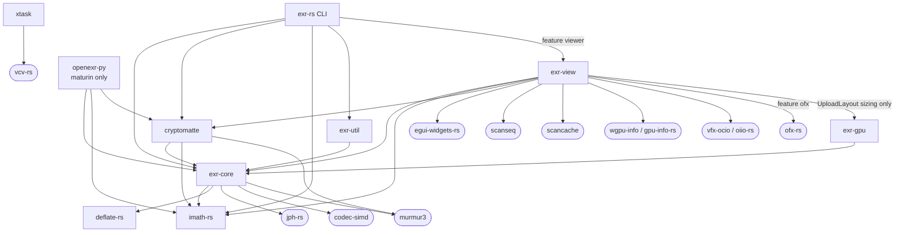
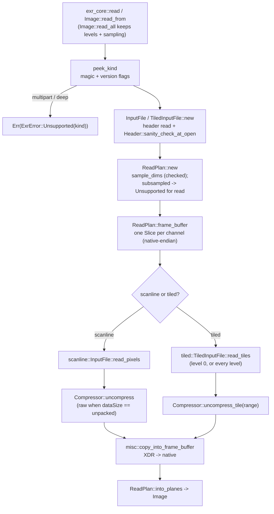
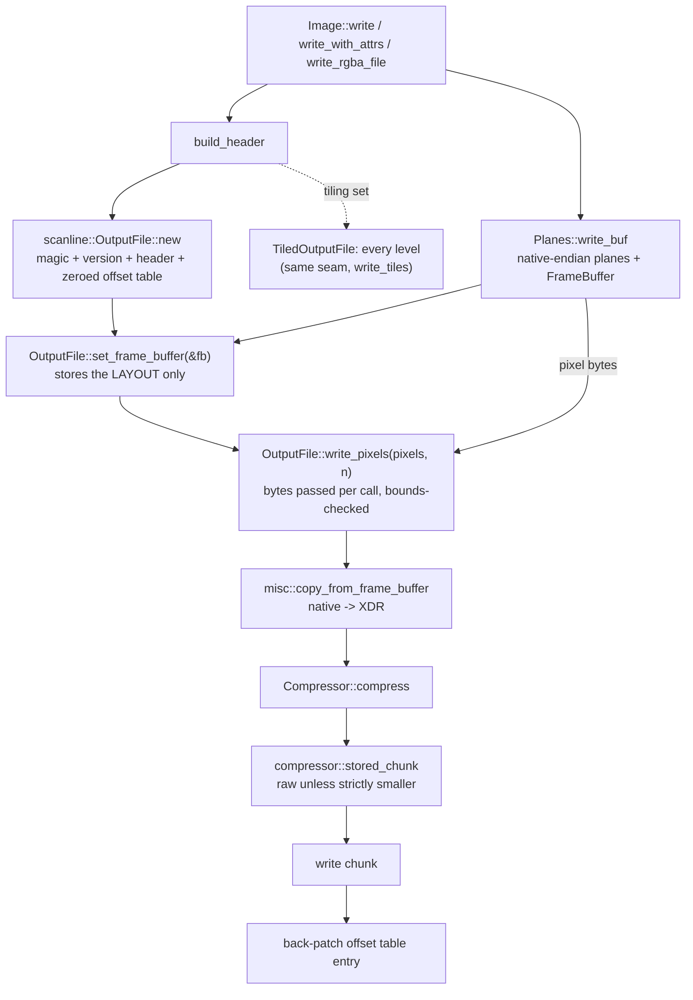
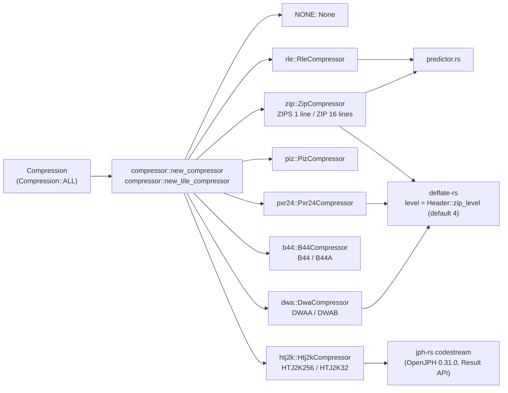
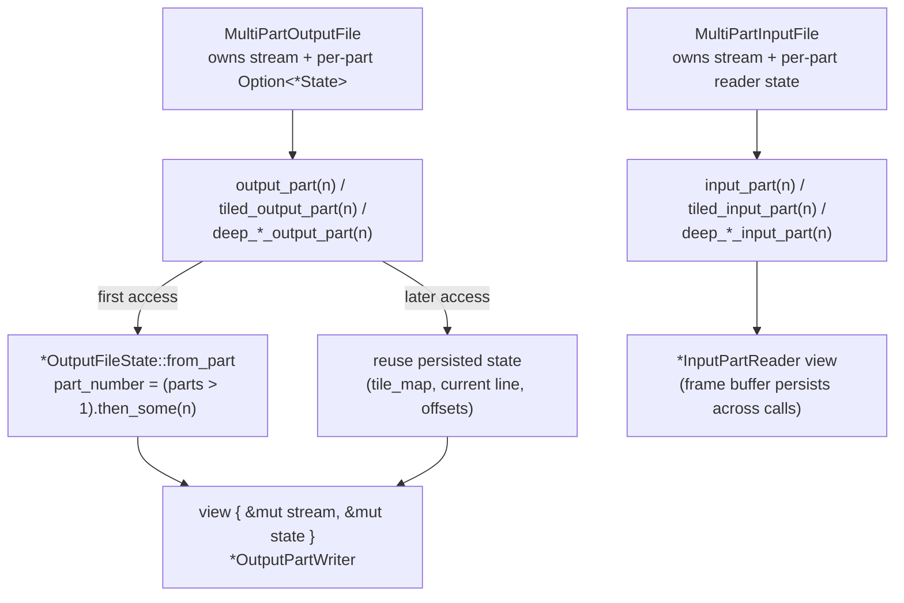
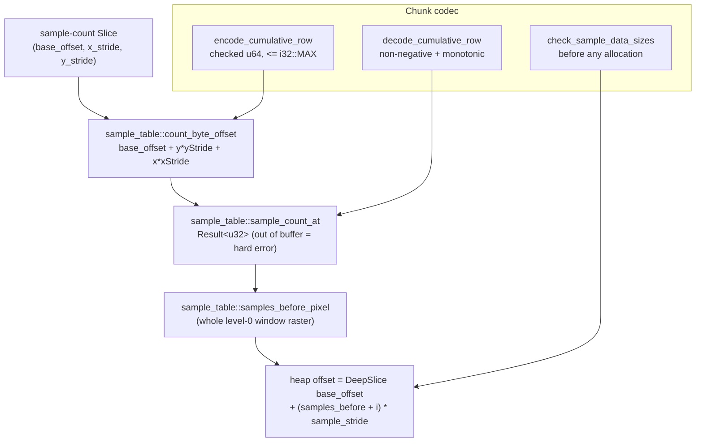
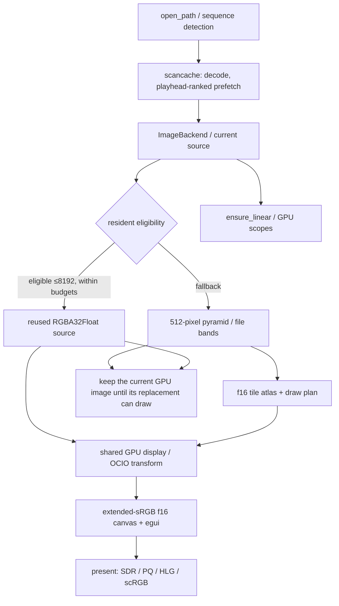
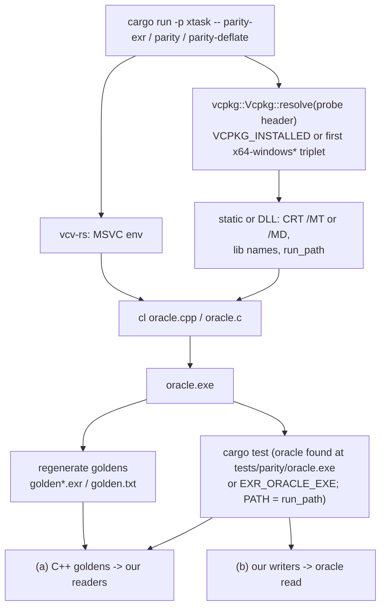
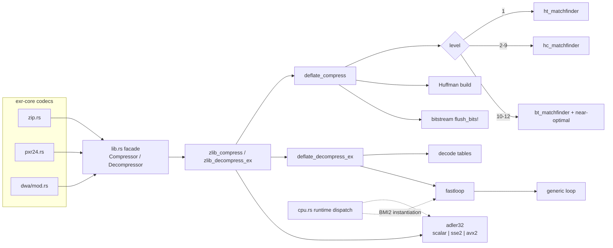

# exr-rs diagrams

Mermaid diagrams of the current architecture. Every node that names a module, type, or
function exists in the code.

## Crate dependency graph

Solid boxes are workspace crates; rounded boxes are git dependencies (own repos).

`exr-gpu` is a library for downstream consumers; the viewer uses only its checked
`UploadLayout` (texture sizing) and keeps its own upload path. `jph-rs` ports OpenJPH 0.31.0
(the version the C++ oracle links); `deflate-rs` ports libdeflate 1.26.

## Read path (facade)

## Write path (facade)

## Codec dispatch

## Multipart part caching

## Deep sample addressing

## Viewer / cache pipeline

The displayed result (with OpenFX effects applied) is one immutable snapshot that the
scopes, viewport readout, Metadata, Pixel Info and Save view all read.

## Parity harness flow

## deflate-rs (libdeflate v1.26 port): compress / decompress

