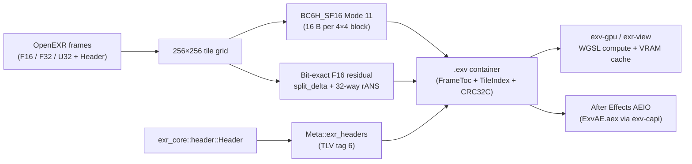

# EXV Video Format & After Effects Plug-in

`.exv` (**EXR Video**) is a multi-frame, tile-indexed HDR video container built directly on
`exr-core`. It turns a sequence of OpenEXR frames into a single memory-mapped file designed for
real-time GPU scrubbing and playback up to 16K × 16K @ 60 fps while preserving **100% of OpenEXR
headers and metadata**.

The full wire specification lives in [`docs/FORMAT.md`](https://github.com/ssoj13/exr-rs/blob/main/docs/FORMAT.md).

## Key capabilities

- **100% OpenEXR header preservation.** Every `.exv` file embeds the original serialized
  `exr_core::header::Header` parts inside `Meta::exr_headers` (TLV tag `6`). Custom attributes,
  `dataWindow` / `displayWindow` offsets, colour tags, multi-layer channel names, and Cryptomatte
  manifests survive `.exr -> .exv -> .exr` round-trips intact.
- **Hardware GPU `BC6H` + lossless residual (`CodecId::BC6H = 7`).**
  - **`bc6h-lossless` (default):** encodes each 4×4 `F16` block as a 16-byte `BC6H_SF16` Mode 11
    block and pairs it with a 32-stream interleaved `rANS` residual stream (`orig_u16 - bc6h_u16`
    after stride-2 byte-plane `split_delta`). Reconstructs the original `F16` values **bit-for-bit**
    on both CPU and GPU.
  - **`bc6h-lossy`:** pure 16-byte `BC6H_SF16` Mode 11 blocks (8 bits per sample, 4:1 compression
    on `F16`) for hardware-rate GPU texture streaming.
- **Additional tile codecs.** `htj2k` (OpenJPH HTJ2K), `fast` (split-delta + 32-stream rANS),
  `wave` (LeGall 5/3 reversible wavelet + rANS), and `rt` (`EXV-RT` DWT + dead-zone quantiser +
  rANS), plus temporal `PRED` P/B delta frames across configurable GOPs (`--gop N`).
- **GPU compute decode (`exv-gpu-kernels` / `exv-gpu`).** Every `.exv` codec — including `BC6H`
  lossy and `BC6H` lossless residual — has a WGSL compute shader pipeline that decodes tiles
  directly into VRAM (`decode_bc6h_into`, `decode_tile_bc6h_vram`, `decode_bc6h_batched`) with
  bit-exact parity against the CPU decoder.



## Command-line usage

### Pack and unpack `.exv` with `exr-rs convert`

```sh
# Convert a single EXR into an EXV container (default codec: bc6h-lossless)
exr-rs convert beauty.exr beauty.exv

# Pack a numbered EXR sequence into a multi-frame EXV video clip with GOP=12
exr-rs convert shot.####.exr shot.exv --exv-codec bc6h-lossless --gop 12

# Encode hardware-rate lossy BC6H_SF16
exr-rs convert shot.####.exr preview.exv --exv-codec bc6h-lossy

# Unpack a multi-frame EXV clip back into a numbered EXR sequence
exr-rs convert shot.exv out.####.exr --compress zip
```

Accepted `--exv-codec` values: `bc6h-lossless` (alias `bc6h`), `bc6h-lossy`, `htj2k`, `fast`,
`wave`, `rt`.

### Inspect `.exv` headers with `exr-rs info`

```sh
exr-rs info shot.exv
```

Prints the `.exv` container summary (`format`, `size`, `channels`, `codec`, `frames`, `gop`,
`tiles`, `fps`) followed by the complete OpenEXR attribute dump of every embedded part header.

### Play `.exv` clips in `exr-rs view`

```sh
exr-rs view shot.exv
```

Opening a multi-frame `.exv` in the viewer loads it directly as a timeline sequence backed by
memory-mapped I/O (`ExvClip`) and the `scancache` playhead engine. Embedded Cryptomatte manifests
and OpenEXR metadata appear in the toolbar and Metadata panel just as they do for `.exr` sequences.

## C ABI (`exv-capi`) and After Effects plug-in (`ExvAE.aex`)

- [`crates/exv-capi`](https://github.com/ssoj13/exr-rs/tree/main/crates/exv-capi) builds
  `exv_capi.dll` / `libexv_capi.so` / `libexv_capi.dylib` and generates [`docs/exv-capi.h`](https://github.com/ssoj13/exr-rs/blob/main/docs/exv-capi.h)
  via `cbindgen`. It exposes zero-copy frame decoding, multi-frame clip writing, and all `.exv`
  codecs (`EXV_CODEC_BC6H = 7`, `EXV_CODEC_HTJ2K = 6`, `EXV_CODEC_EXV_RT = 5`, `EXV_CODEC_RANS = 1`,
  `EXV_CODEC_WAVELET = 2`).
- [`cpp/exv-ae`](https://github.com/ssoj13/exr-rs/tree/main/cpp/exv-ae) builds the native Adobe
  After Effects AEIO plug-in (`ExvAE.aex`) for importing and exporting `.exv` clips with `BC6H`,
  `HTJ2K`, `EXV-RT`, and `rANS` profiles.

Build and deploy the After Effects plug-in on Windows with:

```sh
python bootstrap.py ae
```
