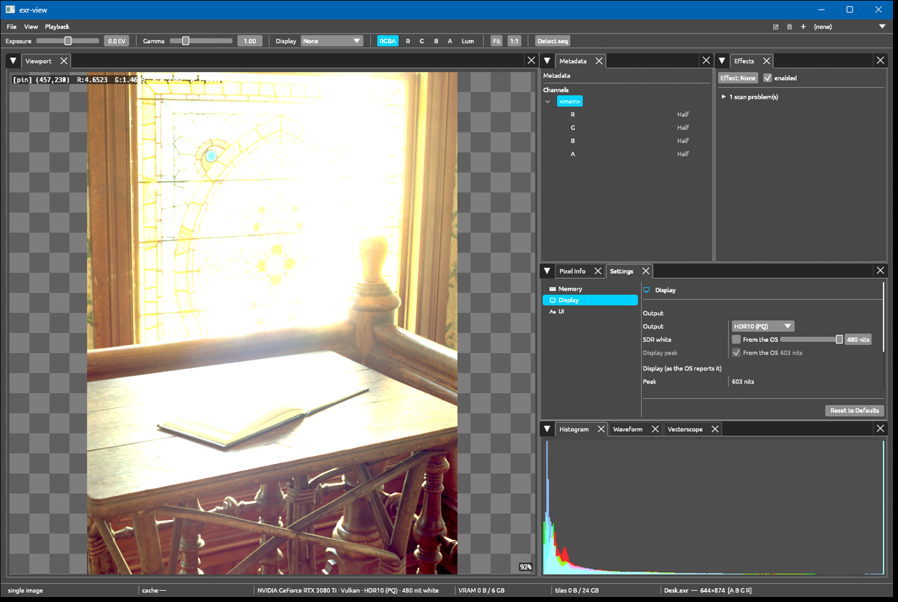
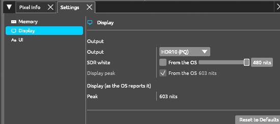

# Viewer

The viewer is the `exr-rs view` (`v`) subcommand, an image and sequence player on
winit, egui and wgpu; its code is the `exr-view` library crate.

```sh
exr-rs v                         # start the viewer (also: exr-rs view)
exr-rs view --help                # viewer options
exr-rs view beauty.exr
exr-rs view --auto beauty.0001.exr
```

Bare `v` or `view` starts the viewer without a path and restores the saved
session; `--empty`/`-e` does the same explicitly. `--help`/`-h` shows help. An
explicit file opens alone unless `--auto` is given (`--no-auto` states the default).
Drag-and-drop detects sequences; the Open dialog and recents use the saved
auto-detect preference. Missing frame numbers remain gaps in the detected sequence.

## Workspace



Actual native-window capture, showing `Desk.exr` on a
Windows Vulkan HDR10 PQ surface. The image is from
[openexr-images](https://github.com/AcademySoftwareFoundation/openexr-images);
its [license and screenshot provenance](../assets/sources.md) accompany the book.
PNG screenshots document the interface; they do not reproduce an HDR monitor's
absolute light output.

The viewport, Metadata, Pixel Info, Settings and scopes are dockable panels.
Metadata contains the Channels tree and original header attributes; the toolbar
selects the layer and RGBA/R/G/B/A/luma display. Click a layer to select it, or a
channel to view it alone. The current layer opens by default; manual folds persist
across redraws, and switching layers reveals the selected layer once. Expand all
and Collapse all sit to the right of Channels.

Metadata also shows the displayed (processed) result's frame, time, data/display
windows and pixel aspect ratio; the original header appears separately when it belongs
to that result's source. Pixel Info shows processed scene-linear RGBA, canvas
coordinates and the sampled pyramid level, plus the original source values of all
channels when that source point is available. Histogram, waveform, vectorscope and
viewport readout keep showing the last completed result while new work is pending.

Under the image's alpha the viewport shows a backdrop picked from the toolbar:
Checker (default), Black, 50% Gray or a custom colour; the choice persists. It is
composited in the present pass in linear light relative to SDR white, so it has
the right brightness on SDR, HDR10 PQ, HLG and scRGB outputs. The default checker
has 16-pixel cells fixed to the viewport; the picker sets the cell size and can pin
the cells to the image so they pan and zoom with it. Exports (Save view) carry no backdrop.

## Navigation and playback

| Input | Action |
|---|---|
| Middle-button drag | Pan |
| Right-button drag | Zoom about the viewport centre |
| Mouse wheel | Zoom toward the cursor |
| `F` | Fit the display window to the current viewport |
| `H` or `0` | Show at 1:1 |
| `Ctrl +` / `Ctrl -` | Step zoom |
| `R` / `G` / `B` / `A` | Isolate a channel |
| `Space` / `Shift+Space` | Play/pause a sequence / play backwards |
| Left/right arrows | Step frames |
| Left-button drag on a sequence | Scrub |
| Left-button click on a still | Pin pixel readout |
| `Z` / `Shift+Z` | Fullscreen / hide panels |

Fit uses the EXR display window; the data window is positioned inside it.
The View menu selects the preload strategy. Worker-thread decoding and the
shared frame cache stay within the configured RAM allowance. During playback the
current image stays on screen until its replacement is ready to draw.

## Display and colour

Source pixels remain scene-linear. The GPU display transform applies exposure,
gamma, channel selection and the selected tone operator or OCIO display/view/look.
A shared extended-sRGB f16 canvas holds the image and UI; the final present pass
encodes the selected output surface.



Settings → Display selects SDR 8/10-bit, HDR10 PQ, HLG or scRGB when the actual
surface supports that format/colour-space pair. SDR white and display peak can use
OS values or explicit overrides. The screenshot shows a saved 480-nit override;
it is not the application default or a calibration recommendation. Reference white sets the brightness of the UI and of relative-white image values on an
HDR output; its manual range is 80–1000 nits, independent of the OCIO rendering peak.
The display-peak override shapes HLG output only.

Settings → Colour holds the OCIO controls (config, input, display, view, look). Quick
monitor presets appear before the detailed input/display/view/look choices,
including HDR 1000 nits when an HDR output and the loaded config support it (it
selects an ACES HDR rendering, not a 1000-nit UI white). Display and Colour link
directly to each other.

Open Settings with `Ctrl+,` or from the Window menu; its categories are Memory,
Display, UI (sequence auto-detection, fonts, interface sizes) and Colour, and Reset
affects the category shown. Settings persist in the platform's exr-view
configuration directory.

Settings → Memory controls RAM/VRAM shares and per-frame upload allowance.
Eligible images up to 8192 pixels per dimension use a reused resident GPU source,
subject to device support and actual allocation/transition budgets. Other images
use the 512-pixel tiled pyramid with coarser-level fallback; file-backed production
reads bounded bands. Small images are not forced through tile loading.

## Save a view

File → Save view exports the selected display look as SDR PNG, HDR10 PQ PNG, HLG PNG
or linear display-light EXR; there is no scRGB file export. Display-light EXR uses
linear Rec.709; its `whiteLuminance` records the current display reference white. A display export does not preserve every original
channel or source metadata.

Save view exports the displayed result's pixels, geometry and time. The requested
maximum dimension selects a pyramid level; mixed fine/coarse coverage uses the same area reducer as scopes.
PNG and EXR writers stream rows without assembling a full f32 image. The success
message reports dimensions and any nonzero pyramid level. While the pixels are still
loading or busy, Save view asks to retry; budget and writer errors are reported instead
of silently exporting the original input.

The CLI's `--screenshot` is a neutral image export without a window, rather than
a capture of the UI. Its neutral display-light EXR uses a 203-nit reference white.
See [CLI examples](cli.md). Use `convert` or the
[library API](library.md) for source-image read/write workflows.

## Other image formats

Besides EXR the viewer opens PNG, JPEG, TIFF, DPX, Cineon, Radiance HDR, BMP, TGA, SGI, ICO, GIF,
WebP, PNM/PFM, IFF, RLA and Softimage PIC (HEIC/HEIF and AVIF are not built in), as sequences
too (`shot.####.png`). EXR keeps its own readers; every other format is decoded by `vfx-io`
(`exr-import`) into the same frame, so exposure, OCIO, scopes, Pixel Info, effects and Save view
work unchanged. The first frame of multi-image files (GIF, ICO, TIFF pages) is shown, and the
file is always held in RAM (no out-of-core pyramid).

Colour follows OpenImageIO: the format reader's colour-space tag wins (PNG honours its `sRGB`/`gAMA`
chunks, Radiance HDR is linear, DPX maps its transfer code, PNM is Rec.709 as in OIIO), and an
untagged file is sRGB when it holds 8/16-bit integers and linear when it holds floats. Cineon and
DPX log (`KodakLog`) use the Kodak printing-density curve (white 685, black 95, step 0.002,
gamma 0.6). Any other tag is resolved through the colour-space table of `vfx-io` (Color Interop IDs
such as `g24_rec709_display`, `lin_ap1_scene`, `pq_rec2020_display`): its curve is applied and
primaries other than Rec.709 are rotated into linear Rec.709 (Bradford-adapted, out-of-gamut values
kept). A tag the table does not know, or that is not RGB (`CMYK`, XYZ), is an error, not a guess.
A sequence frame that fails to decode is marked red on the timeline and is not retried until its
file changes; the viewport and the log say why. The Metadata panel starts with the source format,
colour space, depth and alpha handling. Straight
alpha (PNG, TGA, WebP, unassociated TIFF) is premultiplied in linear light; other formats are
taken as associated, as OIIO does.

File > Open remembers the last folder and the last format filter across openings and restarts
(Save view remembers its own folder); the filter list is the format registry.

## OpenFX and current limits

The Effects dock hosts the built-in effects and installed OpenFX plug-ins (from
`OFX_PLUGIN_PATH` and the OS plug-in directories), with parameters, overlays and
plug-in scan diagnostics. Effects read source pixels lazily through checked f32
region providers within a bounded CPU memory budget; their output feeds the scopes,
viewport readout, Metadata, Pixel Info and Save view. If preparing a non-tiled effect
exceeds the budget before rendering begins, the viewer may render it from a coarser
whole-image level; a refusal once rendering has begun does not fall back. Not yet
done: HLG verification on HLG hardware, exposure for log-encoded input, and scRGB
file export.

Deep and multipart files report an unsupported-input error; use the corresponding
low-level readers for those file shapes. Subsampled channels are decoded whole and
scaled to the data window; luminance/chroma inputs also provide reconstructed RGB.
Window geometry, docks, controls, recents and budgets persist between runs.
